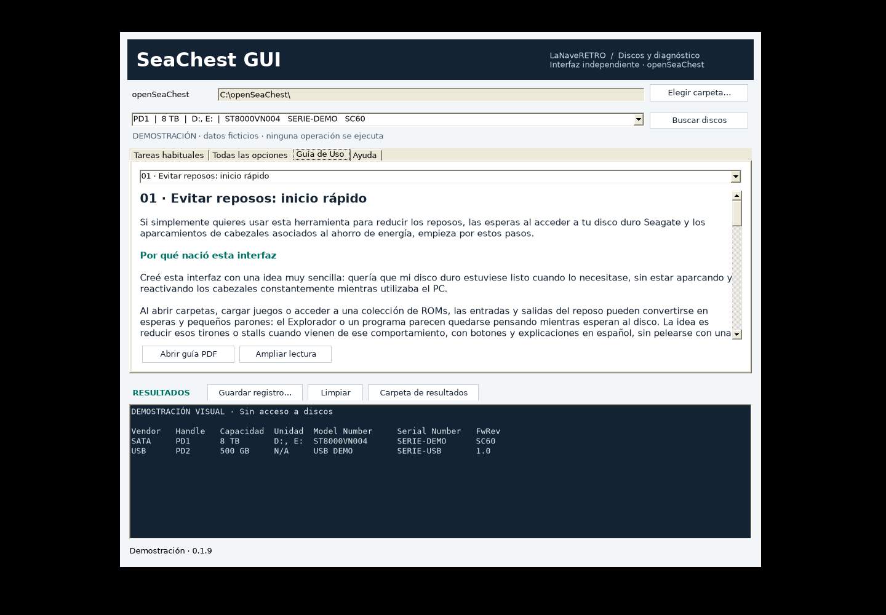

# SeaChest GUI · LaNaveRETRO

Interfaz gráfica independiente en español para **openSeaChest de Seagate**. Permite consultar discos, iniciar diagnósticos y acceder a las opciones de las herramientas desde Windows, sin escribir comandos en una consola.

**Versión: 0.1.8 · Windows 10/11 · .NET Framework 4.8 · Licencia MIT para la GUI**

Proyecto comunitario independiente, sin afiliación ni certificación de Seagate. Los ejecutables de openSeaChest se descargan por separado.

## Descargar y empezar

1. Abre **Releases** en este repositorio y descarga `SeaChestGUI_v0.1.8_Windows.zip`. Los archivos automáticos «Source code» contienen el código para desarrolladores.
2. Descarga la distribución de [openSeaChest para Windows](https://github.com/Seagate/openSeaChest/releases) adecuada a tu equipo y extráela.
3. Extrae el ZIP de la GUI y copia `SeaChestGUI.exe`, `SeaChestGUI.exe.config`, el PDF y la carpeta `LICENCIAS` junto a `openSeaChest_Basics.exe`. Conserva también los avisos originales de Seagate.
4. Abre `SeaChestGUI.exe` y acepta la solicitud de administrador. También puedes elegir la carpeta de herramientas desde la aplicación.
5. Espera la búsqueda automática, identifica el disco por modelo y número de serie y comienza por **Información del disco**.

La aplicación es portátil y requiere .NET Framework 4.8. Para utilizarla no necesitas Python, PowerShell ni conexión a Internet. El ejecutable no está firmado digitalmente.

## Qué puedes hacer

### Utilidad principal: reducir reposos y aparcados de cabezales innecesarios

**Evita que tu disco duro Seagate entre en reposo o aparque los cabezales demasiado a menudo mientras utilizas el PC.** En modelos compatibles, SeaChest GUI permite ajustar o desactivar las funciones de ahorro energético EPC/APM que provocan ese comportamiento, desde una interfaz gráfica y sin escribir comandos.

El «parking» consiste en retirar los cabezales a su posición de descanso. Si ocurre con demasiada frecuencia entre accesos, el disco debe volver a colocarlos para leer o escribir. Cuando además se detiene el motor, también necesita tiempo para recuperar su velocidad.

¿En qué puede ayudarte?

- **Menos esperas al acceder al disco:** puede evitar pausas al abrir carpetas, cargar juegos, acceder a una biblioteca de ROMs o reproducir archivos cuando la causa es la salida del reposo.
- **Menos ciclos mecánicos innecesarios:** permite reducir aparcados y reactivaciones repetidos, con el objetivo de limitar el desgaste asociado a esos ciclos y cuidar el disco a largo plazo. **No garantiza un alargamiento de su vida útil**, que depende también de temperatura, uso y estado de la unidad.
- **Un comportamiento más constante:** resulta útil en discos de datos que consultas con frecuencia y que prefieres mantener disponibles durante la sesión.
- **Ajustes que puedes comprobar y restaurar:** la **Guía de Uso** explica cómo consultar la configuración, aplicar los cambios compatibles, verificar el resultado y volver a los valores anteriores.

Estos ajustes no impiden todos los aparcados: Windows, el firmware o una caja USB pueden gestionarlos por separado. Mantener el disco activo puede aumentar consumo y temperatura. Su disponibilidad depende del modelo y la conexión; el aparcado normal es una función prevista por el fabricante y no significa por sí mismo que el disco esté fallando.

Si este es tu objetivo, empieza por la primera sección de la pestaña **Guía de Uso** o por la [guía en PDF](Guia_de_Uso_SeaChestGUI_v0.1.8.pdf).

Referencia técnica: [explicación sobre aparcado y ahorro energético en el repositorio oficial de openSeaChest](https://github.com/Seagate/openSeaChest/discussions/82).

### También puedes

- Buscar discos al arrancar y actualizar la lista con **Buscar discos**, por ejemplo al conectar una unidad USB.
- Ver capacidad y letras de Windows tanto en el selector como en los resultados; `N/A` indica que no se han comunicado letras y `n/d` que el dato no está disponible.
- Consultar información, SMART, estadísticas y salud NVMe, según la compatibilidad del disco.
- Iniciar pruebas DST cortas o largas y consultar su progreso e historial.
- Explorar las opciones de cada módulo instalado y componer operaciones desde **Todas las opciones**.
- Guardar el registro visible y abrir la carpeta de resultados.
- Leer la **Guía de Uso**, ampliar su lectura o abrir su PDF.

El catálogo se obtiene de la ayuda de los ejecutables instalados. La disponibilidad de una opción depende del modelo, firmware, interfaz y versión de openSeaChest; la GUI no garantiza que todas las combinaciones funcionen en todos los discos.

## Guía de uso

La guía comienza por cómo reducir los reposos de un HDD mediante EPC/APM, comprobar el resultado y restaurar la configuración. Después explica el resto de funciones en lenguaje sencillo.

- [Guía en PDF (19 páginas)](Guia_de_Uso_SeaChestGUI_v0.1.8.pdf)
- [Guía en texto](docs/GUIA_DE_USO.txt)
- [Cambios por versión](CHANGELOG.md)

Cambiar el ahorro energético puede aumentar consumo y temperatura. No garantiza una mayor vida útil ni evita los temporizadores independientes de algunas cajas USB.

## Vista de la aplicación

Captura con datos ficticios en Linux/Mono. El aspecto de controles y fuentes puede variar en Windows.

## Antes de modificar un disco

Comprueba modelo y número de serie y conserva una copia de los datos que necesites. Borrar, formatear, cambiar sectores, modificar seguridad o actualizar firmware puede destruir datos o dejar una unidad inaccesible. No uses esas operaciones para comprobar si la GUI detecta discos.

La aplicación comprueba de nuevo la identidad antes de operar, solicita confirmación en modo avanzado y bloquea ese modo cuando WMI identifica el disco del Windows actual. Estas medidas no sustituyen la comprobación del usuario: la identificación puede no estar disponible en algunas controladoras.

«Consulta finalizada correctamente» significa que la consulta no devolvió un error; no certifica la salud del disco ni que una prueba interna haya terminado. Consulta siempre el progreso y el resultado de la operación correspondiente.

## Compilar y contribuir

El código está en `src/`. En Windows, con el compilador de .NET Framework disponible, ejecuta **COMPILAR.cmd** desde el Explorador. Genera `SeaChestGUI.exe` en la raíz; el PDF y la guía integrada ya están incluidos y no hay que regenerarlos para compilar.

Consulta [desarrollo y validación](docs/DESARROLLO.md) y [cómo contribuir](CONTRIBUTING.md). Las pruebas usan datos ficticios; no ejecutan operaciones sobre discos físicos.

La versión se compiló contra las referencias oficiales de Microsoft .NET Framework 4.8 y se verificó el manifiesto de administrador. Se hicieron pruebas de lógica y revisión visual en Linux/Mono. La aceptación completa sobre Windows, WMI, controladoras y discos reales no está certificada; consulta el [registro de pruebas](tests/RESULTADOS.txt).

## Créditos y licencias

- **LaNaveRETRO**: proyecto SeaChest GUI y documentación original; asistencia de desarrollo y redacción con OpenAI/Codex.
- **Seagate y colaboradores de openSeaChest**: herramientas de acceso y gestión de discos. [Repositorio oficial](https://github.com/Seagate/openSeaChest).
- **DejaVu Fonts y sus titulares**: fuentes incorporadas al PDF.

El código original de la GUI y su documentación original se distribuyen bajo [MIT](LICENSE). Las licencias de terceros conservan sus propios términos; MIT no los sustituye. Consulta [THIRD_PARTY_NOTICES.md](THIRD_PARTY_NOTICES.md) y la carpeta [LICENCIAS](LICENCIAS).
